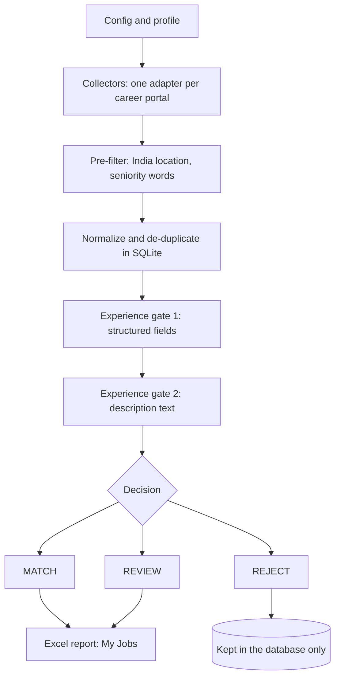

# Job Finder Automation

A personal job-search tool that collects openings directly from company career portals, filters them against your profile (roles, locations, experience), and gives you one Excel sheet of jobs worth applying to, with a direct apply link for each.

It is built for freshers and early-career candidates in India (internships and 0 to 2 years), but the profile is configurable.

> **Status:** personal project, actively developed. It prefers an honest "no match today" over padding the list with jobs that don't fit.

## Features

- **Official career portals only.** Jobs come from public career-site endpoints (Workday, Oracle HCM, SuccessFactors RSS, company JSON feeds, TurboHire), with official job IDs and direct application URLs.
- **Profile matching.** Target roles, preferred locations, skills, and negative keywords decide what is relevant.
- **Double experience filter.** Gate 1 reads structured fields from the portal. Gate 2 reads the description text. Jobs that ask for more experience than you allow are rejected with the reason.
- **Three decisions.** Every job is `MATCH`, `REVIEW` (unclear, check manually), or `REJECT`, and every decision has a stated reason.
- **Seniority and level filters.** Rejects Senior, Sr, Lead, Principal, Staff, Manager, Director, Architect, and level markers such as II, III, IV, or L5+.
- **No duplicates.** A SQLite database de-duplicates jobs across runs and keeps your application status, notes, interview details, and follow-up dates.
- **Honest source health.** Each source reports `COMPLETED`, `PARTIAL` (capped or rate-limited), or `FAILED`. One broken source never stops the run.
- **Excel report and dashboard.** An Excel workbook with clickable apply links, plus a local FastAPI dashboard.
- **Tested.** A pytest suite uses saved sample responses, so tests run offline.

## How it works



A job is `MATCH` only if a gate positively finds a stated minimum within your limit, or the title says intern, trainee, graduate, fresher, entry level, or new grad. If no experience information exists anywhere, the job is `REVIEW` with the reason "experience not stated".

## Supported sources

| Platform | Companies |
|---|---|
| Accenture careers API | Accenture |
| Workday (CXS JSON) | Adobe, Intel, NVIDIA, Salesforce, Walmart, Mastercard, Visa, PayPal |
| Company JSON feeds | Amazon, Infosys |
| Oracle Cloud HCM | Oracle, Dell |
| SAP SuccessFactors RSS | Capgemini, Wipro, HCLTech |
| TurboHire | Flipkart |

Each platform has one reusable, config-driven adapter in `app/sources/`. Adding a company on an existing platform is a configuration change, not new code.

**Not supported.** Microsoft, Google, Cognizant, IBM, SAP, TCS and Tech Mahindra block automated access or require a login, so they are left out on purpose. Job-board connectors (LinkedIn, Naukri, Lever, Greenhouse, SmartRecruiters) exist in the code but are disabled.

## Requirements

- Python 3.10 or newer
- Windows (the batch scripts target Windows; the Python code itself is not Windows-specific)
- Internet access to the career portals

## Installation

```bat
git clone https://github.com/<your-username>/job-finder-automation.git
cd job-finder-automation
python -m venv venv
venv\Scripts\pip install -r requirements.txt
```

## Configuration

Settings live in a `.env` file and the project configuration. Common options:

| Setting | Purpose |
|---|---|
| `MAX_REQUIRED_MIN_YEARS` | Highest minimum experience you accept (default `1`) |
| `ACCENTURE_MAX_JOBS` | Per-run cap for Accenture |
| `COMPANY_JSON_MAX_JOBS_PER_COMPANY` | Per-run cap for company JSON feeds |
| `COMPANY_JSON_COMPANIES`, `ORACLE_HCM_COMPANIES`, `SUCCESSFACTORS_COMPANIES`, `TURBOHIRE_COMPANIES` | Which companies each adapter runs for |
| `*_CUSTOM_CONFIGS` | JSON overrides to add a company on an existing platform |

Edit your profile (target roles, preferred locations, skills, negative keywords) in the project configuration.

Example profile:

| | |
|---|---|
| Roles | Python, Backend, Software Engineer/SDE, Full Stack, Web, AI/ML Engineer, related internships |
| Locations | Delhi/New Delhi, Noida, Bengaluru, Ahmedabad, India-eligible remote |
| Experience | Fresher, internship, 0 to 2 years |
| Excluded | Senior, Lead, Principal, Staff, Manager, Director, Architect, 5+ years |

> Never commit `.env` or the `data/` folder. They can contain settings and your personal application history.

## Usage

Run the pipeline:

```bat
venv\Scripts\python.exe -m app.main
```

Open the reports folder:

```bat
explorer data\exports
```

Start the dashboard, then open <http://127.0.0.1:8000>:

```bat
scripts\run_dashboard.bat
```

## The Excel report

The default workbook has one sheet, **My Jobs**, listing only `MATCH` and `REVIEW` jobs, with `MATCH` first:

| Column | Meaning |
|---|---|
| Decision, New? | `MATCH` or `REVIEW`, and `NEW` if first seen in this run |
| Company, Job Title, Location, Experience | The job, as published |
| Why | The reason for the decision |
| Apply Link | Clickable direct link to the official application page |
| Posted, Job ID, Date Found | Dates and the official requisition ID |
| Application Status, Follow-up Date, Notes | Your tracking, preserved across runs |

Run with `--full-report` to also produce the complete multi-sheet workbook (all jobs, analytics, search intelligence, and so on). Rejected jobs are never deleted; they stay in the database and the full report.

Each run also prints a summary: collected, `MATCH`, `REVIEW` and `REJECT` counts per company, plus any `PARTIAL` sources and why.

## Testing

```bat
venv\Scripts\pytest tests\
```

Adapter tests use saved sample responses in `tests/samples/`, so they run without network access.

## Project layout

```
app/
  main.py          entry point (python -m app.main)
  sources/         one adapter per platform (Workday, Oracle HCM, SuccessFactors, company JSON, TurboHire, ...)
tests/             pytest suite
tests/samples/     saved sample API responses
scripts/           Windows batch launchers (dashboard, runner)
data/exports/      generated Excel reports
data/jobs.db       SQLite database (not committed)
```

## Limitations

- Some sources are capped per run or by the portal itself (for example, SuccessFactors RSS returns about 20 items per query). Capped sources are labelled `PARTIAL`, so a `MATCH` list is not a guarantee that every suitable vacancy was found.
- Experience is read from structured fields and description text, and portals phrase it inconsistently. Treat `REVIEW` jobs as leads and read the posting before applying.
- Public endpoints can change without notice, so adapters may need updates.
- Zero matches in a run can be correct. The filters are not meant to be loosened just to produce results.

## Responsible use

- Intended for personal job searching and learning.
- The tool uses publicly reachable career-site endpoints at low volume. It does not bypass CAPTCHAs, logins, or bot protection, and sources that block automation are left out.
- Follow each site's terms of use. Verify every posting on the company's official page before applying.
- Not affiliated with or endorsed by any company listed above. Job data belongs to the respective employers.

## Roadmap

- Re-enable job-board sources, one at a time and only where access is permitted
- Wider coverage for capped sources and early-career queries
- Smarter detection of experience requirements
- More company career portals

## Contributing

Issues and pull requests are welcome. Please run the full test suite before opening a PR, and use saved sample responses (clearly labelled as samples) for adapter tests. Do not add fabricated job data.
